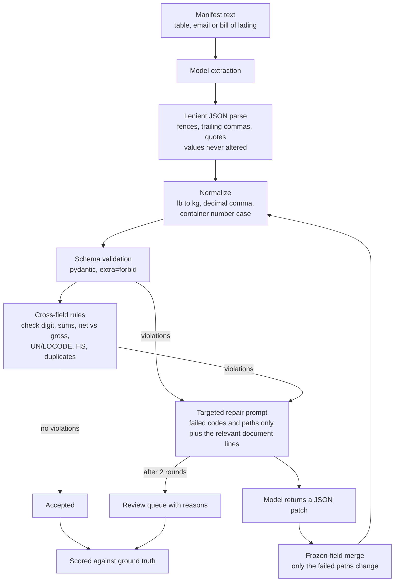

# manifestfix

[](https://github.com/SlateGitOrg/manifestfix/actions/workflows/ci.yml)


manifestfix validates and repairs LLM extraction of freight manifests. It parses almost-JSON model output without altering values, validates it against a strict pydantic schema, and then runs cross-field rules (ISO 6346 container check digits, weight and package sums, net against gross, UN/LOCODE and HS code checks) that catch output which is valid but wrong. When a check fails, it re-asks the model only about the violated rule and path, merges the returned patch with every other field frozen, and sends a document that still fails after two rounds to a review queue. An offline evaluation on 300 synthetic documents compares three configurations against ground truth and counts silent errors.

## The problem

Freight forwarders use an LLM to turn emailed packing lists and bills of lading into JSON for customs filings. Schema validation catches broken JSON. It does not catch a container number with transposed digits, line weights left in pounds, or a dropped container line. All of these are schema-valid, and any of them can get a shipment held at the port.

Two obvious responses both fall short. A generic "that was invalid, try again" retry burns model calls without telling the model what to fix, so it usually reproduces the same mistake. Silently accepting the output moves the cost to the port, where a wrong container number means days of delay. manifestfix measures both, and shows what a targeted repair buys.

## How it works



Modules, in pipeline order:

- `lenient_json.py` scans the text once, tracking string state, and applies repairs only outside strings: markdown fences, surrounding prose, trailing commas, single-quoted strings, Python literals and `//` comments. Every repair is logged.
- `normalize.py` converts pounds to kilograms (0.45359237), reads decimal-comma numbers when the document's locale hint calls for it, and upper-cases container numbers and strips their spaces.
- `schema.py` holds the pydantic v2 models. Every model sets `extra="forbid"`, and `incoterm` is an enum of the 11 Incoterms 2020 rules.
- `rules.py` has nine cross-field rules, each with a stable code and a JSON path: `ISO6346_CHECK_DIGIT`, `NET_GT_GROSS`, `SUM_PACKAGES`, `SUM_GROSS` (0.5% tolerance), `SUM_VOLUME`, `UNLOCODE_UNKNOWN` (a bundled list of 146 ports), `HS_CODE_FORMAT` (6 to 10 digits), `DUPLICATE_CONTAINER` and `GROSS_OVER_MAX` (above 30,480 kg).
- `repair.py` runs the loop. The repair prompt lists only the failed codes with their paths and the document lines that mention the affected container or totals. `patch.py` merges the model's answer: an edit outside the failed paths is discarded.
- `model.py` defines the `ExtractionModel` protocol, an offline `FakeExtractor` and an `OpenAICompatModel` (JSON mode over any OpenAI-compatible endpoint).
- `generator.py`, `layouts.py` and `faults.py` produce the synthetic documents, ground truth and fault plan. `evaluate.py` scores the configurations.

## Quick start

```bash
python -m venv .venv && source .venv/bin/activate
pip install -e ".[dev]"

manifestfix seed                        # 300 documents, ground truth and a fault plan into data/
manifestfix eval --configs all          # the three-configuration comparison
manifestfix extract data/docs/MF-0007.txt --trace   # one document, with the repair trace
manifestfix check-digit CSQU3054383     # ISO 6346 check
pytest -q
```

To run against a real model instead of the offline one, set `MANIFESTFIX_LLM_BASE_URL`, `MANIFESTFIX_LLM_API_KEY` and `MANIFESTFIX_LLM_MODEL` and pass `--model openai` to `extract`. `MANIFESTFIX_LIVE=1 pytest -m live` runs the optional live test.

## Example output

The data is synthetic. `manifestfix seed` writes 300 documents with 1,041 container lines, a fault plan with 115 faulted documents and the ground truth. `manifestfix eval --configs all`:

```text
                              Outcomes over 300 documents
┏━━━━━━━━━━━━━━━━┳━━━━━━━━━━━━━━━━━━┳━━━━━━━━━━━━━━━┳━━━━━━━━┳━━━━━━━━━━━━━━━━━━━━━━━━┓
┃ Config         ┃ Accepted-correct ┃ Silent errors ┃ Review ┃ Calls per accepted doc ┃
┡━━━━━━━━━━━━━━━━╇━━━━━━━━━━━━━━━━━━╇━━━━━━━━━━━━━━━╇━━━━━━━━╇━━━━━━━━━━━━━━━━━━━━━━━━┩
│ schema-only    │              230 │            70 │      0 │        1.067 (320/300) │
│ rules+blind    │              210 │             0 │     90 │        2.286 (480/210) │
│ rules+targeted │              295 │             0 │      5 │        1.339 (395/295) │
└────────────────┴──────────────────┴───────────────┴────────┴────────────────────────┘
```

- `schema-only` accepts all 300 documents and 70 of them are wrong: 20 with weights left in pounds, 20 with a transposed container number, 15 with a dropped line and 15 with net and gross swapped. All 70 are schema-valid.
- `rules+blind` has no silent errors, but a generic retry fixes nothing the rules found. That outcome is true by construction of the offline model, which repairs a fault only when the prompt names its code and path and never when the prompt is the blind "try again"; it does not measure how a real model responds to a blind retry. All 90 documents with a schema or rule fault run both repair rounds and end in review, which costs 2.286 calls per accepted document.
- `rules+targeted` fixes 85 of those 90 in one round each. The 5 left are the stubborn transpositions, which the offline model never gets right. They end in review with `ISO6346_CHECK_DIGIT`, and the pipeline does not compute a digit to fix them.

Those counts are derived from the fault plan before the pipeline runs, and `eval` prints them next to the measured ones:

```text
Expected from the fault plan alone:
  schema-only: 230 correct, 70 silent, 0 review, 320 calls
  rules+blind: 210 correct, 0 silent, 90 review, 480 calls
  rules+targeted: 295 correct, 0 silent, 5 review, 395 calls
```

Per-field exact accuracy over the accepted documents (header and totals fields are 100.0% in all three configurations and are omitted here). The denominators differ by configuration: header and totals fields are scored over 300, 210 and 295 accepted documents, and container-line fields over the 1,041, 709 and 1,022 truth container lines of those documents, for `schema-only`, `rules+blind` and `rules+targeted`. The percentages are therefore not comparable across columns as rates over the same documents:

```text
┃ Field                   ┃ schema-only ┃ rules+blind ┃ rules+targeted ┃
│ containers.container_no │       96.6% │      100.0% │         100.0% │
│ containers.gross_kg     │       90.8% │      100.0% │         100.0% │
│ containers.net_kg       │       90.8% │      100.0% │         100.0% │
│ containers.seal_no      │       98.6% │      100.0% │         100.0% │
```

One document trace, `manifestfix extract data/docs/MF-0007.txt --trace`. The model read container 5 as `NKJU3122306`; the document says `nkju 3122360`.

```text
MF-0007 trace (rules+targeted)
  model call 1: extract
  failed: ISO6346_CHECK_DIGIT at containers[4].container_no
  model call 2: repair round 1
  accepted

repair prompt 1:
The previous extraction failed validation. Correct only the failures listed below. Every other field is frozen and any change to it is discarded.
Reply with a JSON object {"patch": [{"op": "replace" or "remove", "path": "<path>", "value": <value>}]} that edits only the listed paths. Re-read the document; do not guess.

Failures:
- ISO6346_CHECK_DIGIT at containers[4].container_no: container number NKJU3122306 fails the ISO 6346 check digit test

Document lines:
> Container 5: nkju 3122360, seal SL4290651, 1.673 BALES, gross 23.411,13 kg, net 19.268,02 kg, 19,92 cbm, HS 2008.99.00, Canned fruit, packed in syrup.

model response 1:
{"patch": [{"op": "replace", "path": "containers[4].container_no", "value": "NKJU3122360"}]}

MF-0007: accepted after 1 repair round(s), 2 call(s)
```

The accepted manifest equals the ground truth. The prompt names one code, one path and the one document line that mentions the container, and the model returns a patch for that path only.

## Design decisions

**Value-preserving lenient parsing instead of a regex clean-up.** A regex that deletes trailing commas will also delete the comma in `"bolts, nuts, 'washers'"`. The scanner tracks whether it is inside a string and edits only outside strings. The cost is a hand-written scanner instead of a one-line `re.sub`, and it covers a fixed list of malformations: anything outside that list still raises and goes to repair.

**Rules identify a path, and prompts name only failed rules.** A violation carries a stable code and the JSON path to re-examine, so the repair prompt can be built from the violations instead of from a template that lists every possible problem. This is what lets the prompt stay short and lets the evaluation compare it with a blind retry. The cost is that some rules (sums, for example) point at a whole list such as `containers`, which gives the model a wide window to edit for a narrow problem.

**The patch merge freezes everything else.** A repair round may return a patch or a whole rewritten object; the merge takes only the failed paths from either and discards the rest. A model that "helpfully" re-formats `vessel` while fixing a container number cannot damage a field that was already right. The cost is that a fix that legitimately needs a second field (for instance a wrong total caused by a wrong line) has to be reported by a rule on that field, otherwise it is discarded.

**The pipeline never computes a check digit to repair a number.** The check digit is evidence that a number was misread, and it cannot say which digit is wrong. Rewriting the last digit would produce a valid number that points at the wrong container, which is the failure this project exists to prevent. A number the model cannot correct from the document goes to review.

**Faults in the offline model are tied to a code and a path.** The fake model repairs a fault only when the prompt names that fault's code and path, and never when it is marked stubborn. That makes the outcome counts exact and derivable from the fault plan, so the evaluation can assert them. It also means the fake is a model of an idealised repair step, not a measurement of any real model: how often a real model fixes a transposition when asked precisely is an empirical question, and the optional live test and `--model openai` exist to ask it.

**Scoring separates valid from correct.** A document counts as accepted-correct only when the accepted manifest equals the ground truth field for field. Per-field accuracy matches container lines to the truth by seal number, so a dropped line costs its own fields and does not shift every line after it.

## Testing

```bash
pytest -q
```

85 tests run offline, plus one live test that is skipped unless `MANIFESTFIX_LIVE=1`. They cover the ISO 6346 published example (`CSQU3054383` valid, `CSQU3045383` invalid with computed digit 1), lenient parsing (including values that contain commas, quotes and comment markers), unit and locale normalization, each rule firing alone on a fixture that violates only that rule, the frozen-field merge, the contents of the transposition repair prompt, the exact outcome table above, the stubborn transpositions ending in review, the cap of two repair rounds, seed determinism, and the CLI. The OpenAI-compatible adapter is tested against an `httpx` mock transport.

## Project layout

```text
src/manifestfix/
  cli.py            typer CLI: seed, extract, check-digit, eval
  schema.py         pydantic models, Violation record
  lenient_json.py   value-preserving pre-repairs
  normalize.py      units, decimal comma, container number clean-up
  iso6346.py        check digit from the standard
  unlocode.py       bundled list of 146 ports
  rules.py          nine cross-field rules
  patch.py          frozen-field merge of repair responses
  repair.py         pipeline, repair prompt, review queue
  model.py          ExtractionModel protocol, FakeExtractor, OpenAICompatModel
  faults.py         fault types, fault plan, fault-to-code mapping
  layouts.py        renderers and parsers for the three text layouts
  generator.py      seeded dataset generator
  evaluate.py       three-configuration scoring and plan-derived predictions
tests/              85 offline tests and one optional live test
```

## License

MIT. See `LICENSE`.
